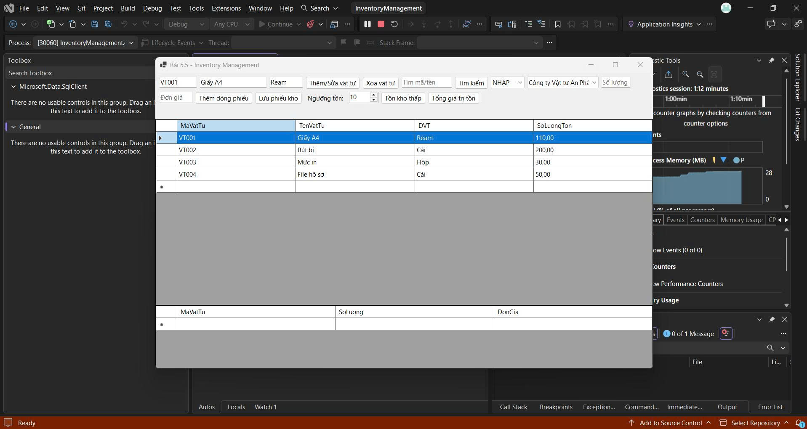
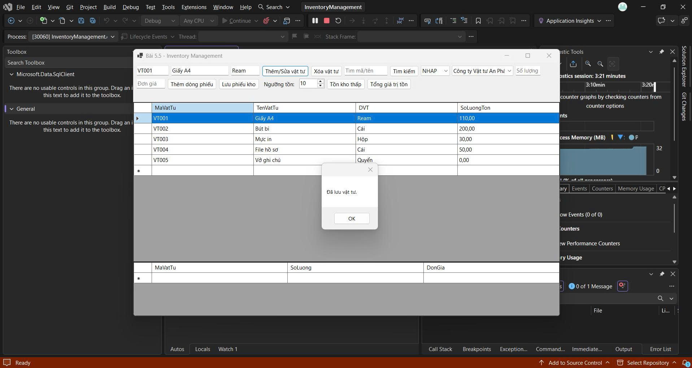
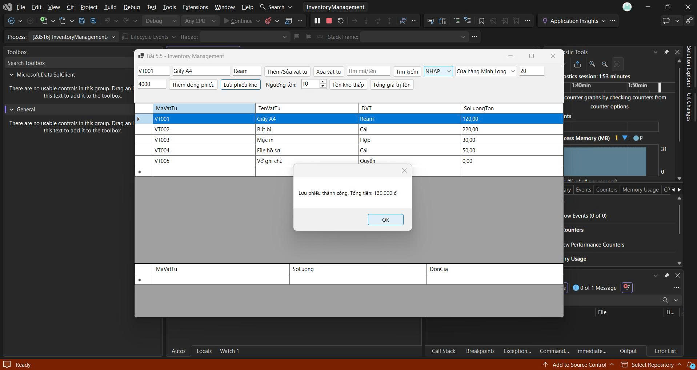
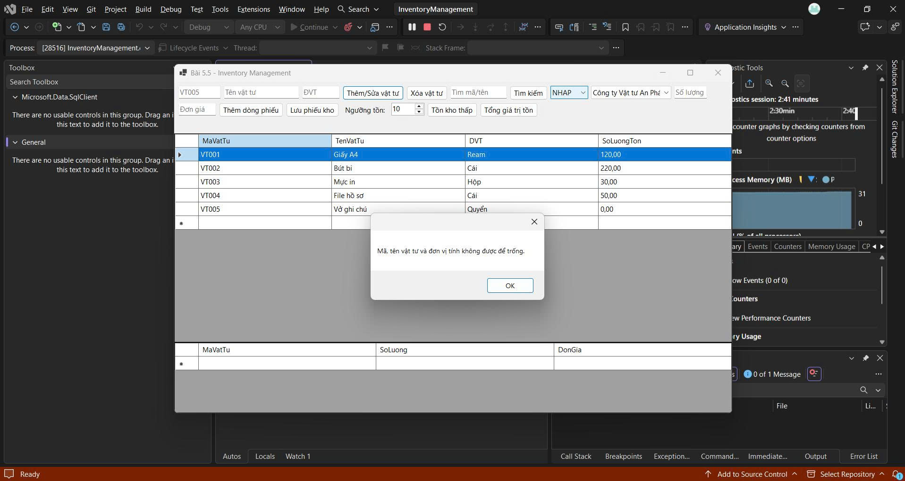

# BÀI 5.5 – QUẢN LÝ KHO (InventoryManagement)

## MỤC 1: THÔNG TIN SINH VIÊN

- **Họ và tên sinh viên:** Nguyễn Trung Thành
- **Mã sinh viên:** 24810310462
- **Tên đề tài / Bài tập:** Bài 5.5 – Quản lý kho (InventoryManagement)

## MỤC 2: HƯỚNG DẪN CÀI ĐẶT & CHẠY DỰ ÁN

### Các bước cài đặt

1. Mở SQL Server Management Studio (SSMS), chạy file `Database/ScriptDB.sql` để khởi tạo cơ sở dữ liệu `InventoryDB` và dữ liệu mẫu.
2. Mở file `.slnx` của dự án bằng Visual Studio 2022.
3. Mở `DatabaseHelper.cs`, sửa chuỗi kết nối `ConnectionString` cho phù hợp với SQL Server trên máy cá nhân.
4. Chọn **Build → Build Solution**, sau đó nhấn **F5** để chạy dự án.

## MỤC 3: HÌNH ẢNH KẾT QUẢ CÁC MÀN HÌNH CHỨC NĂNG

### 1. Màn hình chính / Tổng quan

### 2. Màn hình quản lý danh mục / Thêm sửa xóa (CRUD)

### 3. Màn hình thực thi nghiệp vụ chính (Lập phiếu kho / Nhập xuất kho)

### 4. Màn hình báo cáo - Thống kê

### 5. Minh họa chống SQL Injection hoặc báo lỗi giao dịch (Rollback)

